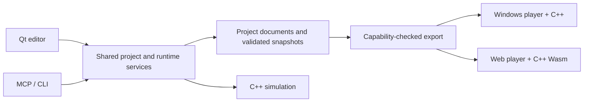

# Current architecture

This page describes the Qt/C++ product. The [initial Electron design](../archive/initial-electron-architecture.md) is retained only as history. See the [platform matrix](../development/platform-support.md) for support limits.

## Product boundaries

| Layer | Source | Responsibility |
|---|---|---|
| Authoring UI | `native/studio` | Qt docks, canvas, inspectors, story/rule tools and route review |
| Editor bridge | `apps/qt-studio` | JSON-lines service over a child Node process; shared editing and validation |
| Project services | `packages/project-service`, `studio-service`, `validation`, `schema` | Documents, revisions, undo/redo, schema/semantic checks and snapshots |
| Simulation | `native/src`, `native/include` | Deterministic C++ rules, state transitions and protocol |
| Session/analysis adapters | `packages/runtime-service`, `analysis-service` and related packages | Command journals, saves, replay, search and regression services |
| Native player | `native/player` | SDL/RmlUi presentation using the same C++ rules |
| Web player | `apps/web`, `apps/player/renderer` | React presentation with the C++ WebAssembly runtime |
| CLI and MCP | `apps/tools` | Structured entry points into the same project/runtime services |
| Extensions | `plugins`, `packages/plugin-host` | Versioned animation/renderer integration; separately installed artifacts |
| Export | `packages/export-service` | Validated content, asset containment, capability checks and standalone bundles |

The older Electron editor and main/preload shells are under `legacy/`. The React renderer is still current Web code. TypeScript rule code remains a compatibility/reference implementation; it is not an implicit fallback for unsupported native behavior.

## Data and command flow

Designers author characters, activities, actions, conditions, effects, stories, progression and presentation in project data. Windows/Web share simulation rules; their rendering feature sets differ and are checked during export. Templates supply convenient starting screens, not hard-coded game modes.

The Qt service and MCP use revision-aware editing transactions. A stale edit must not silently overwrite a newer revision. Source documents remain distinct from immutable execution snapshots, and analysis jobs retain the content version they started with.

Runtime changes are commands against explicit state, including deterministic RNG state. Presentation sends commands and renders projections; it must not implement a second set of economy or relationship rules. Save/replay uses content/version identity and command history. Content updates require an explicit compatibility or migration path.

## Extensibility

Designer rule packages add supported conditions, effects and progression through validated declarative contracts. They are not unrestricted script execution. Animation extensions use the published plugin boundary and platform-specific runtime artifacts. Repository reorganization must not rename serialized fields, alter ABI contracts or silently migrate installed plugins.

## Verification

- Schema and semantic checks report document locations and rule causes.
- Deterministic scenarios, saved journeys and goal routes test replay and ending/event reachability within their search budget.
- Qt widget tests verify actual authoring interactions; direct JSON generation alone is not GUI evidence.
- Native automation and browser tests verify presentation, input and save restoration separately from headless simulation.
- Current capability manifests constrain export. A shared core does not establish mobile, console, or full renderer parity.

Start with [development setup](../development/README.md), the [data contract](data-format/contract.md), [native runtime](../../native/README.md), [MCP](mcp.md) and [authoring manual](../manual/README.md).